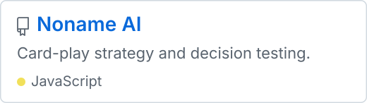

# WeiqiaoCode

**Game AI for Noname** · 微雀qiao

I maintain Noname AI, a decision-making extension for the Noname card game, and contribute gameplay changes upstream.

## Featured Project

  <a href="https://github.com/WeiqiaoCode/noname-ai"><picture>
    <source media="(prefers-color-scheme: dark)" srcset="assets/noname-ai.svg">
    
  </picture></a>

## Noname

- `noname-ai-lab`
- `noname-ai--private`
- `noname-character-lab`
- `noname-ol-ui`

## Open Source Contributions

- **Noname** — Added Guozhan gameplay content and updated OL characters. [Merged #4443](https://github.com/libnoname/noname/pull/4443), [merged #4447](https://github.com/libnoname/noname/pull/4447)
- **feisheng_ai** — Improved teammate coordination and card-play decisions in 2v2. [Merged #13](https://github.com/xuejianbing/feisheng_ai/pull/13)

## Tech Stack

**JavaScript** for game AI · **Node.js** for automated checks

---

[Public repositories](https://github.com/WeiqiaoCode?tab=repositories) · [Contribution activity](https://github.com/WeiqiaoCode#contribution-activity)
