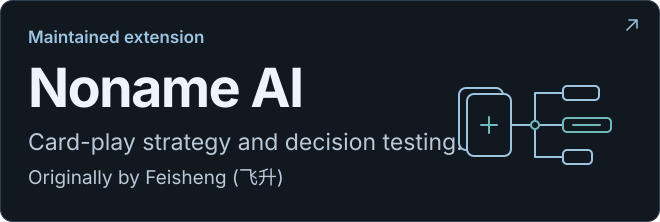
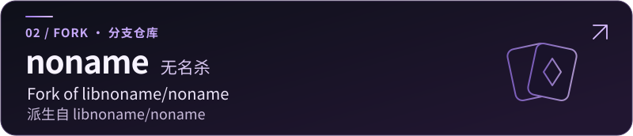
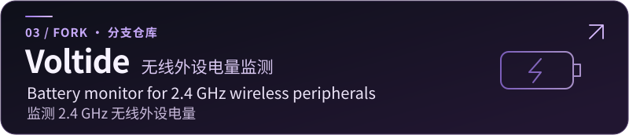

# WeiqiaoCode

## About · 关于我

My public repositories cover Noname game AI and a tool for monitoring wireless peripheral batteries.  
我的公开仓库涵盖无名杀游戏 AI 和无线外设电量监测工具。

## Projects · 项目

### Game Style · 游戏风格

### Game Development · 游戏开发

### Other · 其他

## Collaborations · 合作与贡献

[Public contribution activity · 查看公开贡献记录](https://github.com/WeiqiaoCode#contribution-activity)

## Tech Stack · 技术栈

| Technology · 技术 | Repositories · 仓库 |
| --- | --- |
| JavaScript | Noname-AI · 无名杀 AI 改进 / noname · 无名杀 |
| C# | Voltide · 无线外设电量监测 |
